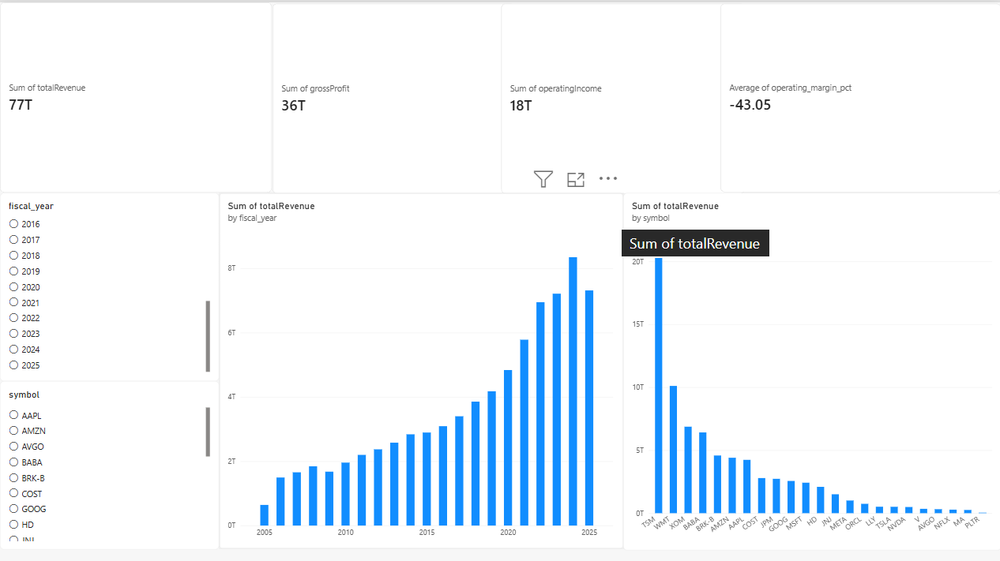

# financial-performance-analysis.
End-to-end financial performance analysis using Python, MySQL, DBeaver, and Power BI following CRISP-DM methodology.

## Repository Contents
* `01_corporate_income_statement.ipynb` — Data cleaning, type standardization, and financial ratio/margin feature engineering in Python
* `02_financial_performance_analysis.sql` — SQL queries and aggregations (run via DBeaver) across fiscal years (`fiscal_year`) and company tickers (`symbol`)
* `corporate_income_statement_clean.csv` — Cleaned dataset (1,746 rows, 23 columns) ready for analysis and visualization
* `financial_performance_dashboard.pbix` — Interactive Power BI Desktop report featuring KPI summary cards, `fiscal_year` and `symbol` slicers, and comparative bar charts

## Workflow Summary
1. **Data Preparation (Python):** Cleaned raw corporate income statement records, verified numeric and date data types, and computed margin and ratio metrics.
2. **Financial Querying (SQL / DBeaver):** Evaluated revenue, gross profit, operating income, and operating margin trends by fiscal year and company.
3. **Interactive Reporting (Power BI Desktop):** Built KPI cards (`Total Revenue`, `Gross Profit`, `Operating Income`, and average operating margin) with interactive filtering by year and company.

## Key Notes
* **Filtering Context:** Unfiltered average operating margin across all records can be pulled lower by negative margin outliers in specific periods or companies, so filtering by `fiscal_year` and `symbol` gives a clearer view of performance.
*
## Dashboard Preview

